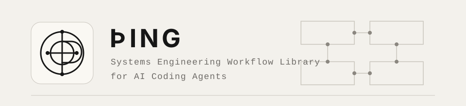
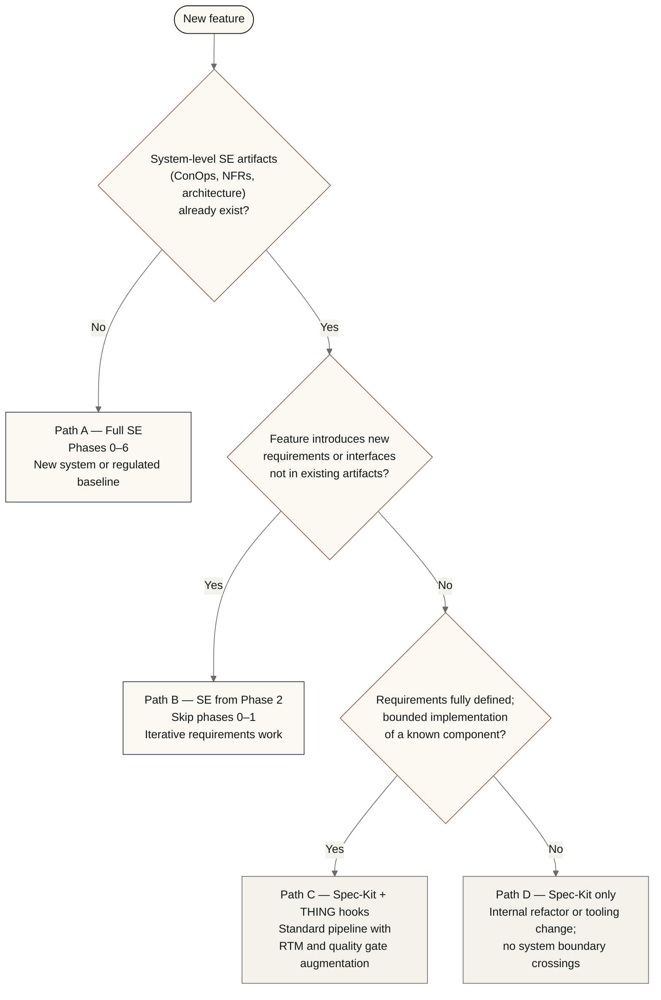

<p align="center">
  
</p>

# THING

**Systems engineering workflows for AI coding agents.**

THING guides an AI coding agent (Claude Code or equivalent) through a full SE
lifecycle — stakeholder elicitation, Concept of Operations, non-functional
requirements, Set-Based Design, requirements derivation, multi-view
architecture, interface control, V&V planning, requirements traceability, and
risk management — all as version-controlled Markdown and Mermaid artifacts
living alongside the code.

THING works standalone or alongside [Spec-Kit](https://github.com/github/spec-kit).
Spec-Kit is not required.

---

## Why THING

Spec-Kit asks: *what do you want to build?*

THING asks first: *who needs it, why do they need it, what qualities must it
have, and how will you prove it works?*

The combined workflow produces a system that is not only built correctly but
built for the right reasons, with evidence at every step.

---

## Intellectual Foundations

THING draws from:

- **INCOSE Systems Engineering Handbook, 5th Edition** — process structure,
  stakeholder needs definition, architecture definition, V&V planning,
  risk management
- **IEEE 29148:2018** — requirements quality attributes
- **ISO/IEC 25010** — system quality characteristics (NFR taxonomy)
- **Views and Beyond** (SEI/Clements et al.) — architecture viewtype
  families and documentation principles
- **C4 Model** (Simon Brown) — pragmatic four-level architecture notation
- **arc42** — architecture documentation structure
- **Set-Based Design / Lean Product Development** (Allen Ward / Toyota)
  adopted as SAFe Principle #3 — assume variability, preserve options
- **Design Thinking** — empathy maps, personas, Jobs to Be Done
  (used as front-end elicitation tools, anchored to verifiable
  problem statements)
- **Mermaid** — all architecture diagrams are text-as-code,
  version-controlled alongside the artifacts they document

---

## Installation

### Recommended — git submodule

Install THING as a submodule in your project repository. This pins your
project to a specific THING version, makes updates explicit and intentional,
and works without Spec-Kit.

```bash
git submodule add https://github.com/konchris/thing .thing
```

To update THING in a project:

```bash
git submodule update --remote --merge
```

### Optional — Spec-Kit extension

If your project uses Spec-Kit and you want hook-based automatic invocation:

```bash
specify extension add https://github.com/konchris/thing
```

This registers THING's commands under the `/thing.{name}` namespace and wires
the hooks defined in `extension.yml`. THING's commands work identically whether
invoked via Spec-Kit hooks or directly.

---

## Invoking Commands

THING commands are Markdown files in `.thing/commands/` (submodule install)
or the Spec-Kit extension directory (Spec-Kit install). Each file is a
complete, self-contained instruction set for the AI agent.

**Direct invocation:**

Tell your agent: *"Read `.thing/commands/se-stakeholders.md` and execute it
for this project."*

**Via slash command (if registered):**

```text
/thing.se-stakeholders
```

**Via Spec-Kit hook:**

Hooks fire automatically after the corresponding Spec-Kit commands when
`extension.yml` is registered. Any THING command can also be invoked directly
at any time.

---

## Choosing a Workflow Path

| You know... | Use |
| --- | --- |
| Nothing yet — new system | Path A: Full SE (phases 0–6) |
| System exists; feature introduces new requirements or interfaces | Path B: SE from Phase 2 |
| Requirements defined; feature is a bounded implementation | Path C: Standard Spec-Kit + THING hooks |
| Simple internal change; no system boundary crossings | Path D: Standard Spec-Kit only |



See [docs/reference/thing-architecture.md](docs/reference/thing-architecture.md) for the full
decision criteria and command sequence for each path.

---

## Command Overview

THING commands are organized around a systems engineering lifecycle:

| Phase | Representative Commands |
| ----- | ----------------------- |
| Stakeholder and operational framing | `se-stakeholders`, `se-conops` |
| Quality and requirements definition | `se-nfr`, `se-requirements`, `se-req-quality` |
| Architecture and interfaces | `se-plan`, `se-architecture`, `se-interfaces` |
| Implementation preparation | `se-tasks`, `se-analyze` |
| Verification, traceability, and risk | `se-vvplan`, `se-rtm`, `se-risk`, `se-gate` |

See [Command Catalog](docs/reference/command-catalog.md) for the full command reference including Spec-Kit relationships and phase mapping.

---

## Repository Structure

THING separates **system-level** artifacts (updated in place across all
feature iterations) from **feature-scoped** artifacts (created fresh per
feature):

```text
specs/
├── system/                          # System-level SE artifacts — one copy, updated each feature
│   ├── 00-stakeholders/
│   │   ├── stakeholder-register.md
│   │   ├── personas/
│   │   ├── empathy-maps/
│   │   └── needs-register.md
│   ├── 01-conops/
│   │   ├── conops.md
│   │   └── operational-scenarios.md
│   ├── 02-nfr/
│   │   └── quality-attributes.md
│   ├── 04-requirements/
│   │   ├── requirements-register.md
│   │   └── req-quality-report.md
│   ├── 05-architecture/
│   │   ├── architecture.md
│   │   ├── views/
│   │   └── decisions/
│   ├── 06-interfaces/
│   │   └── icd.md
│   ├── 09-vv/
│   │   ├── vv-plan.md
│   │   └── vv-results.md
│   ├── 10-risk/
│   │   └── risk-register.md
│   └── rtm.md
└── features/
    └── {feature-id}-{feature-name}/  # Feature-scoped artifacts — one set per feature
        ├── 03-explore/
        │   ├── explore-summary.md
        │   ├── option-{id}/
        │   └── elimination-record.md
        ├── 07-plan/
        │   └── plan.md
        ├── 08-tasks/
        │   └── tasks.md
        └── gate-reports/
```

System-level artifacts describe the system as a whole and are updated
in place with each feature iteration. Feature-scoped artifacts
capture the exploration and planning work specific to a single feature.

---

## Design Principles

**Everything as code.**
All SE artifacts are plain text (Markdown) or text-based diagrams
(Mermaid) committed to the repository. Version-controlled,
diff-able, reviewable in pull requests. A failing RTM check
can block a PR merge just like a failing unit test.

**Threaded artifacts are never skipped.**
The risk register, V&V plan, and RTM are not end-of-project
reports. They are initiated early and updated as an obligation
of each subsequent command. The constitution's SE obligations
section makes this explicit to the AI at every invocation.

**Phase gates enforce completeness.**
No phase closes until `/se-gate N` passes. Gates check threaded
artifact currency, not just sequenced artifact existence.

**Set-Based Design over premature convergence.**
Options are eliminated only when evidence rules them out.
Opinion is not evidence. Elimination rationale is always recorded.

**Verifiability is a requirement quality attribute.**
A requirement without a verification method is incomplete
by definition. The V&V plan entry must exist before the
requirement is baselined.

**Separation of verification and validation.**
Verification confirms the system meets its specification.
Validation confirms the system solves the stakeholder's actual
problem. Both are required. Passing verification against the
wrong specification is not success.

---

## Domain Applicability

THING is domain-neutral but particularly suited to:

- Medical devices (ISO 13485, IEC 62304, ISO 14971)
- Aerospace and defence (DO-178C, MIL-STD-882, ARP4754)
- Automotive (ISO 26262, ASPICE)
- Industrial automation (IEC 61508, IEC 62443)
- Any system where auditability, traceability, and
  formal V&V are required

For purely regulated domains, consult the applicable standard
for additional requirements beyond what THING provides.
Safety case documentation (GSN, IEC 61508 safety cases) is
not currently in scope.

---

## Contributing

Contributions welcome. Please open an issue before submitting
a pull request for significant changes.

Areas where contributions are particularly valuable:

- Domain-specific presets (medical device, aerospace, automotive)
- Additional architecture view templates
- Integration with issue trackers (Jira, GitHub Issues, Linear)
- Automated RTM coverage checks as CI pipeline steps

---

## Licence

MIT — see [LICENSE](LICENSE)

---

## Acknowledgements

Built on [Spec-Kit](https://github.com/github/spec-kit) by
GitHub (Den Delimarsky and John Lam).

Informed by the systems engineering community, the SEI Software Architecture
community, and the practitioners who have demonstrated that rigorous SE
process and modern AI-assisted development are not in tension — they
are complementary.
