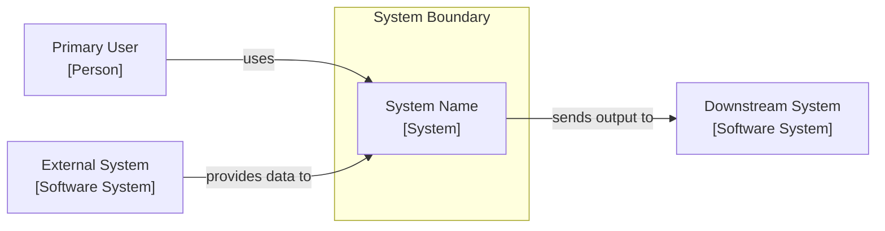

# SE Architecture

## Purpose

Document the system architecture through multiple views, each
answering a different stakeholder question. No single diagram
represents an architecture. A complete architecture description
requires views from multiple viewtype families, narrative rationale,
and explicit documentation of significant decisions and rejected
alternatives.

This skill follows:

- **Views and Beyond** (SEI/Clements et al.) — viewtype families
  and documentation principles
- **C4 Model** (Simon Brown) — four-level software notation
- **arc42** — architecture documentation structure
- **INCOSE Systems Engineering Handbook, 5th Edition** — functional
  and physical architecture for systems with hardware content
- **SysML concepts** — block diagrams, IBDs, activity diagrams
  (expressed as Mermaid, not requiring a SysML tool)

Output artifacts:

- `specs/system/05-architecture/architecture.md`
- `specs/system/05-architecture/views/context.md`
- `specs/system/05-architecture/views/container.md`
- `specs/system/05-architecture/views/component.md`
- `specs/system/05-architecture/views/functional-flow.md`
- `specs/system/05-architecture/views/module-layers.md`
- `specs/system/05-architecture/views/deployment.md`
- `specs/system/05-architecture/views/physical.md`
  (systems with hardware only)
- `specs/system/05-architecture/views/hardware-block.md`
  (systems with electronics only)
- `specs/system/05-architecture/views/power-signal.md`
  (systems with electronics only)
- `specs/system/05-architecture/decisions/adr-{NNN}-{title}.md`
  (one per significant decision)
- `specs/features/$FEATURE_ID/05-architecture/architecture-delta.md` (feature delta)

Updates:

- `specs/system/rtm.md`
- `specs/system/09-vv/vv-plan.md`
- `specs/system/10-risk/risk-register.md`

## Pre-Conditions

- `.specify/memory/constitution.md` must exist. Read it.
- `specs/features/$FEATURE_ID/07-plan/plan.md` must exist.
  This is the output of `/thing.se-plan`. Read it.
- `specs/system/02-nfr/quality-attributes.md` must exist.
  Read it. NFRs drive architectural decisions.
- `specs/system/04-requirements/requirements-register.md`
  must exist. Read it.
- `specs/system/01-conops/conops.md` must exist. Read it.
  Operational scenarios stress the architecture.
- `specs/features/$FEATURE_ID/03-explore/explore-summary.md` should
  exist. If it does, read it — the selected option's rationale
  informs the architecture narrative.

If `specs/features/$FEATURE_ID/07-plan/plan.md` does not exist,
stop and tell the user to run `/thing.se-plan` first.

## Baseline-Update Mode

The system-level artifacts this skill writes are a baseline: one
current description of the whole system, not a log of features.
This applies to:

- `specs/system/05-architecture/architecture.md`
- `specs/system/05-architecture/views/*.md`
- `specs/system/05-architecture/decisions/adr-{NNN}-{title}.md`

and to every edit this skill makes to a threaded artifact (risk
register, V&V plan, RTM).

Before writing, check whether each artifact already exists.

- **Does not exist** — this is the first feature to touch it.
  Write it from the template in the Instructions below.
- **Exists** — merge into it. Never add a section for this feature
  (no "§7 Feature 011", no "Feature 012 additions") and never
  write a second copy of a table that already exists.

When merging:

1. Read the existing artifact in full before changing anything.
2. The architecture narrative and every view describe the current
   system. Edit the existing diagram rather than adding a second
   one for this feature; remove elements the feature takes out of
   the system. The decision index, quality scenarios, risks and
   glossary each live in one table. Accepted ADRs are immutable: a
   changed decision is a new ADR, numbered from the highest
   existing ADR + 1, and the old ADR's status becomes
   `Superseded by ADR-{NNN}`.
3. Add new rows to the existing table. Edit changed rows in place;
   where the history matters, add
   "revised {YYYY-MM-DD}, {feature ID}" to the row's notes.
4. Retire rows that are no longer true: strike through the text
   (`~~…~~`), set the status to `Retired` (for an ADR,
   `Superseded` or `Deprecated`), and keep the row so its ID stays
   reserved. Record the reason in the feature delta, not in the
   baseline.
5. Rewrite prose so it describes the system as it is after this
   feature. A sentence this feature has made untrue is corrected,
   not left standing beside a newer one.
6. Keep IDs stable. Never renumber and never reuse an ID. New IDs
   start at the highest existing ID + 1.
7. Set the header to `**Baseline as of:** {feature ID}, {date}`.

Then list the services, interfaces, behaviours and constraints
this feature adds, removes or changes. Search the artifacts of
this and earlier development steps for statements about each
one:

- `specs/system/00-stakeholders/`
- `specs/system/01-conops/`
- `specs/system/02-nfr/`
- `specs/system/04-requirements/`
- `specs/system/05-architecture/`
- `specs/system/rtm.md` (threaded; this skill updates it)
- `specs/system/09-vv/vv-plan.md` (threaded; this skill updates it)
- `specs/system/10-risk/risk-register.md` (threaded; this skill updates it)

Correct every statement in them that the feature has made
untrue, including in artifacts that earlier skills own.
Re-assess every risk, V&V entry or RTM row in the artifacts
above whose mitigation or subject the feature removes or
changes.

Do not search or edit the artifacts of later development steps
(`06-interfaces/` under `specs/system/`). Their skills bring them
up to date when they run for this feature, and each phase gate
checks them.

Finally, write the feature delta
`specs/features/$FEATURE_ID/05-architecture/architecture-delta.md`
using the template at `artifacts/baseline-delta.md`. If it already
exists (this skill ran earlier for the same feature), append to
its tables. Record:

- **System Changes** — the list above
- **Baseline Edits** — one row per item or prose section added,
  changed or retired, in any artifact listed above, with the
  reason
- **Statements Checked** — existing statements reviewed against
  the System Changes and left unchanged because they are still
  true

Write the delta on the first feature too; there every edit is
`Added`.

## Instructions

### Step 1 — Read Context

Read all pre-condition artifacts. Build an internal picture of:

- The system type and domain from the constitution
- The selected solution option from explore-summary (if present)
- The technical approach from plan.md
- The Must Have NFRs — these are architectural drivers
- The operational scenarios — particularly failure and degraded
  modes, which stress the architecture hardest
- Any constraints: technology mandates, existing systems,
  regulatory requirements affecting architecture

### Step 2 — Determine System Type and View Set

Tell the user: *"Before we document the architecture, I need
to understand what types of subsystems are present so I
produce the right set of views."*

Ask:

1. Does this system include software components?
   (almost always yes — confirm)
2. Does this system include electronic hardware components?
   (custom PCBs, embedded controllers, sensors, actuators,
   power supplies, communication hardware)
3. Does this system include mechanical components?
   (enclosures, mounting, mechanisms, thermal management,
   fluidics, optics)
4. Are there safety-critical subsystems that require
   functional safety allocation documentation?
   (which functions are allocated to which safety integrity
   level or software safety class)

Based on answers, determine the view set:

**Software-only system:**
Context, Container, Component, Functional Flow,
Module Layers, Deployment

**Software + Electronics:**
All software views plus Physical Architecture,
Hardware Block, Power and Signal Flow

**Full system (SW + Electronics + Mechanical):**
All above plus mechanical integration notes within
the Physical Architecture view

**Safety-critical addition (any type):**
Functional Safety Allocation table within the
Physical Architecture view

### Step 3 — Architecture Drivers

Tell the user: *"The architecture must be explicitly driven
by requirements — particularly the NFRs. Let's identify
the architectural drivers: the requirements that have the
most significant influence on structural decisions."*

For each Must Have NFR, ask:

1. Does this NFR constrain how the system is decomposed?
   (e.g. security NFR → separate trust boundaries;
   availability NFR → redundant components;
   performance NFR → async processing, caching)
2. Does this NFR constrain how components communicate?
   (e.g. real-time NFR → synchronous, low-latency path;
   reliability NFR → message queuing, retry logic)
3. Does this NFR constrain where components are deployed?
   (e.g. data residency → specific geographic deployment;
   air-gap requirement → no cloud components)

Document the top architectural drivers — the NFRs and
requirements that most significantly shaped the structure.
These become the opening rationale of `architecture.md`.

### Step 4 — Significant Decision Identification

Tell the user: *"Architecture decisions are the choices that
are hard to reverse, have broad impact, or involve genuine
trade-offs between competing quality attributes. Each one
needs a documented rationale and a record of what was
rejected and why."*

Ask the user to identify the significant decisions made
in or implied by `plan.md`. Prompt with:

- Technology or framework selections
- Communication patterns (synchronous vs. async,
  REST vs. messaging vs. event streaming)
- Data storage choices (SQL vs. NoSQL, local vs. remote,
  centralised vs. distributed)
- Deployment model choices (monolith vs. microservices,
  on-premise vs. cloud, embedded vs. hosted)
- Security boundary placements
- Redundancy and failover strategies
- For hardware systems: processor selection, bus architecture,
  power architecture, communication protocol selection

For each decision identified, note:

- What was decided
- What alternatives were considered
- What drove the choice (which NFR or constraint)
- What the consequences are (positive and negative)

Each significant decision becomes one ADR.

### Step 5 — Produce Views

Work through each view in the required set. For each view:

- Describe what the view shows before drawing it
- Generate the Mermaid diagram
- Add a brief prose explanation of the key elements
  and relationships shown
- Note which requirements or NFRs the view relates to

#### View 1 — System Context (C4 Level 1)

**Viewtype:** Allocation (system boundary)
**Answers:** What is the system and what does it interact with?
**Audience:** All stakeholders including non-technical

Show:

- The system as a single box at centre
- All external actors (users, operators, external systems)
  that interact with it
- The nature of each interaction (labelled arrows)
- System boundary explicitly drawn

Mermaid diagram type: `C4Context` or `graph LR`

Example structure:



#### View 2 — Container / Subsystem (C4 Level 2)

**Viewtype:** Component-and-Connector (C&C) — runtime structure
**Answers:** How is the system decomposed into major
deployable or physical units?
**Audience:** Technical stakeholders, architects, leads

Show:

- Each major container: applications, services, databases,
  message buses, embedded firmware images, hardware units
- How containers communicate: protocol, data format,
  synchronous vs. async
- Which containers are owned by this system vs. external

Mermaid diagram type: `graph TD` or `C4Container`

Label each container with:

- Name
- Type (Web App, API, Database, Message Queue,
  Embedded Firmware, Hardware Unit, etc.)
- Technology (if decided)

#### View 3 — Component (C4 Level 3)

**Viewtype:** Module — internal structure of key containers
**Answers:** How is each container internally structured?
**Audience:** Developers, detailed designers

Produce one Component view for each container that has
significant internal complexity. Do not produce this view
for simple or thin containers.

Show:

- Internal components within the container
- Responsibilities of each component
- Internal interfaces between components
- Entry points from outside the container

Mermaid diagram type: `graph TD`

#### View 4 — Functional Flow

**Viewtype:** C&C — behaviour over time
**Answers:** What functions exist, in what sequence do
they execute, and how do they relate to operational scenarios?
**Audience:** Systems engineers, safety engineers, testers

This view corresponds to the Functional Flow Block Diagram (FFBD).
It shows functions as activities and the flow of control and data
between them.

For each major operational scenario from the ConOps,
produce a functional flow showing:

- Triggering event
- Sequence of functions activated
- Decision points and branches
- Error and exception paths
- Terminal states (success and failure)

Mermaid diagram type: `flowchart TD` or `sequenceDiagram`

Use `sequenceDiagram` when the interaction between
multiple components over time is the key concern.
Use `flowchart` when the logical flow of a single
process is the key concern.

#### View 5 — Module Layers

**Viewtype:** Module — allowed dependencies
**Answers:** What are the structural layers and what
dependencies are allowed between them?
**Audience:** Developers, architects, code reviewers

Show:

- Layers from highest (most abstract, user-facing) to
  lowest (most concrete, infrastructure)
- Allowed dependency directions (typically top-down only)
- Which components or modules belong to which layer
- Any layer violations that are known and accepted
  (document as ADR if significant)

Mermaid diagram type: `graph TD` with subgraph per layer

#### View 6 — Deployment / Allocation

**Viewtype:** Allocation — software to infrastructure
**Answers:** Where does each container run?
What hardware or infrastructure does it execute on?
**Audience:** Operations, infrastructure, safety engineers

Show:

- Physical or virtual nodes (servers, devices, VMs,
  containers, embedded targets)
- Which software containers are deployed to which nodes
- Network connections between nodes (protocol, port,
  encrypted/unencrypted)
- Environmental context (cloud region, on-premise rack,
  embedded device, vehicle ECU)

Mermaid diagram type: `graph LR` with subgraph per node

---

*The following views are produced only for systems with
hardware content as determined in Step 2.*

---

#### View 7 — Physical Architecture

Hardware systems only.

**Viewtype:** Physical Architecture
**Answers:** How are system functions allocated to physical
elements? What is the system's physical decomposition?
**Audience:** Systems engineers, hardware engineers,
safety engineers, regulators

Show:

- Physical subsystems (SW subsystem, electronics subsystem,
  mechanical subsystem, power subsystem)
- Function-to-element allocation: which functions from
  the functional flow are allocated to which physical element
- Safety integrity level or software safety class allocation
  (if safety-critical)
- Physical interfaces between subsystems

Mermaid diagram type: `graph TD` with subgraph per subsystem

Include a function allocation table beneath the diagram:

```markdown
| Function ID | Function Name | Allocated To | Safety Class | Notes |
| ----------- | ------------- | ------------ | ------------ | ----- |
```

#### View 8 — Hardware Block Diagram

Electronics systems only.

**Viewtype:** SysML Block Definition Diagram (BDD) equivalent
**Answers:** What hardware elements exist and how are
they structurally connected?
**Audience:** Hardware engineers, electronics engineers,
procurement, safety engineers

Show:

- All hardware blocks: processors, FPGAs, sensors,
  actuators, power management ICs, communication modules,
  memory, connectors
- Structural connections between blocks
- Bus types (I2C, SPI, UART, CAN, Ethernet, USB, etc.)
- Power rails supplying each block

Mermaid diagram type: `block-beta` or `graph LR`

#### View 9 — Power and Signal Flow

Electronics systems only.

**Viewtype:** Electrical SE functional view
**Answers:** How does power propagate through the system?
How do signals flow between hardware elements?
**Audience:** Electronics engineers, safety engineers,
EMC engineers

Produce two sub-diagrams:

**Power Flow:**

- Power source(s) → regulation stages → consumers
- Voltage levels at each stage
- Protection elements (fuses, TVS, crowbar)
- Isolation boundaries

**Signal Flow:**

- Key signal paths from sensor/input to processor to output/actuator
- Signal conditioning stages
- Digital/analogue conversion points
- Isolation or level-shifting stages

Mermaid diagram type: `flowchart LR`

---

### Step 6 — Write Architecture Decision Records

For each significant decision identified in Step 4,
write one ADR file:
`specs/system/05-architecture/decisions/adr-{NNN}-{kebab-title}.md`

Number ADRs sequentially from the highest existing ADR + 1
(from 001 if none exist). Never edit an accepted ADR to change
its decision — supersede it.

```markdown
# ADR-{NNN}: {Decision Title}

**Date:** {date}
**Status:** Accepted | Superseded by ADR-{NNN} | Deprecated
**Deciders:** {who made this decision}
**Feature:** {feature ID}

---

## Context

{Describe the situation that required a decision. What
forces were at play? What constraints existed? Which NFRs
or requirements drove this? Be specific — reference
NFR IDs and requirement IDs where applicable.}

## Decision

{State the decision clearly and specifically. Not "we chose
a good architecture" but "we decomposed the system into
three containers: X, Y, and Z, communicating via Z protocol,
because NFR-PERF-001 requires sub-100ms response and
synchronous REST calls between X and Y would introduce
unacceptable latency under peak load conditions."}

## Consequences

### Positive
{What becomes easier or better as a result of this decision}

### Negative
{What becomes harder or worse — technical debt incurred,
constraints imposed on future decisions, risks introduced}

### Neutral
{What changes without being clearly better or worse}

## Alternatives Considered

### Alternative 1: {name}

**Description:** {what this alternative would have done}
**Rejected because:** {specific reason — reference evidence
where possible. "We didn't like it" is not acceptable.
Reference NFR violations, feasibility constraints, or
evidence from /se-explore where available.}

### Alternative 2: {name}

{repeat structure}

## Related

- Supersedes: {ADR-NNN or None}
- Related requirements: {REQ-IDs}
- Related NFRs: {NFR-IDs}
- Related explore option: {OPT-ID or None}
```

### Step 7 — Write Architecture Narrative

Write `specs/system/05-architecture/architecture.md`, or merge
into it if it exists (see Baseline-Update Mode)
using the arc42 structure. Not all sections need to be
deeply populated at this stage — mark sections that will
be elaborated later as `Status: Stub`.

```markdown
# Architecture Documentation

**System:** {system name}
**Baseline as of:** {feature ID}, {date}
**Feature deltas:** `specs/features/*/**/*-delta.md`
**Status:** DRAFT
**Last Updated By:** se-architecture skill
**Notation:** C4 Model + Views and Beyond + arc42

---

## 1. Introduction and Goals

### 1.1 Purpose of This Document
{What this document covers and its relationship to other
SE artifacts}

### 1.2 Architectural Drivers
{The NFRs and requirements that most significantly shaped
the architecture. Reference NFR IDs. This is the "why"
that explains the structure.}

| Driver ID | Type | Description | Architectural Impact |
| --------- | ---- | ----------- | -------------------- |
| NFR-PERF-001 | NFR | Sub-100ms response | Async processing required |

### 1.3 Quality Attribute Scenarios
{For each architectural driver NFR, describe the
stimulus-response scenario that the architecture must satisfy:
Stimulus → Source → Environment → Artefact → Response →
Response Measure}

---

## 2. Constraints

### 2.1 Technical Constraints
{Technology mandates, existing systems, platform requirements}

### 2.2 Organisational Constraints
{Team structure, skills, timeline, budget}

### 2.3 Regulatory Constraints
{Standards compliance requirements that constrain architecture}

---

## 3. System Scope and Context

*See: `views/context.md`*

{Prose description of the system boundary and external
interactions. Who uses the system? What does it depend on?
What depends on it?}

---

## 4. Solution Strategy

{The core architectural approach in one to two paragraphs.
The essence of the architecture — what key decisions were
made and why. This is the executive summary of all the ADRs.}

{Reference the selected option from explore-summary if
Set-Based Design was conducted.}

---

## 5. Building Block View

### 5.1 Container Level
*See: `views/container.md`*

{Prose description of the major containers and their
responsibilities. One paragraph per container.}

### 5.2 Component Level
*See: `views/component.md`*

{Prose description of key components within each container.
Focus on the non-obvious — explain components whose purpose
or responsibility boundary is not self-evident from the name.}

---

## 6. Runtime View

*See: `views/functional-flow.md`*

{Prose walkthrough of key runtime scenarios. Reference
the operational scenarios from ConOps. Explain how the
architecture responds to normal operation, degraded
operation, and failure.}

---

## 7. Deployment View

*See: `views/deployment.md`*

{Prose description of the deployment topology. Where does
each container run? What are the network paths? What are
the trust boundaries?}

---

## 8. Physical Architecture
*(Hardware systems only)*

*See: `views/physical.md`*

{Prose description of the physical decomposition and
function allocation. What is allocated to software, to
electronics, to mechanical? How does the physical structure
satisfy the safety requirements?}

---

## 9. Architecture Decisions

*See: `decisions/` folder*

### Decision Index

| ADR | Title | Status | Key NFRs |
| --- | ----- | ------ | -------- |
| ADR-001 | {title} | Accepted | NFR-PERF-001 |

---

## 10. Quality Scenarios

{For each Must Have NFR, describe how the architecture
satisfies it. This section is the evidence that the
architecture is fit for purpose.}

| NFR ID | Quality Attribute | Architectural Mechanism | Evidence/Rationale |
| ------ | ----------------- | ----------------------- | ------------------ |

---

## 11. Risks and Technical Debt

{Architectural risks and known technical debt. These
are added to the risk register — this section summarises
and cross-references.}

| Risk/Debt ID | Description | Impact | Mitigation |
| ------------ | ----------- | ------ | ---------- |

---

## 12. Glossary

{Domain and architecture-specific terms used in this
document that are not defined in the constitution}

| Term | Definition |
| ---- | ---------- |
```

### Step 8 — Update Threaded Artifacts

#### RTM Update

For each requirement in the requirements register, update
the Design Element column in `specs/system/rtm.md`
with the container or component that implements it.
Where a requirement is satisfied by multiple elements,
list all of them.

#### V&V Plan Update

For each requirement whose verification stage was TBD,
update to the appropriate stage now that the architecture
is known:

- Requirements satisfied within a single component → IT
  (Integration Test)
- Requirements spanning multiple containers → ST
  (System Test)
- Requirements involving external systems → AT
  (Acceptance Test)

#### Risk Register Update

**Risk ID assignment:** Before appending new entries, scan
the register for all existing `RISK-NNN` IDs and determine
the maximum N. Assign new IDs starting from `max_N + 1`.
Never derive the next ID from the last row alone — use the
maximum across the entire document to prevent collisions.
Set `Status` = `Open` and `Residual P`, `Residual C`,
`Residual Level` = `—` for all newly created entries.
Update the Summary table counts after adding entries.

Add entries for:

- Each architectural risk identified in Section 11
  of architecture.md
- Any NFR whose architectural mechanism is unproven
  or relies on an assumption not yet validated
- Any ADR where the rejected alternatives were
  eliminated by preference rather than evidence

### Step 9 — Confirm Completion

Report to the user:

1. System type confirmed and view set produced
2. List of view files created with one-line description each
3. Number of ADRs written
4. Number of architectural drivers documented
5. RTM design element coverage percentage
6. V&V plan entries updated with verification stage
7. Number of risk entries added
8. Any views marked as stub requiring further elaboration
9. Recommended next skill:
   `/thing.se-interfaces`

Also report the feature delta path, the number of baseline
items added, changed and retired, and every statement corrected
in an artifact this skill does not own.
