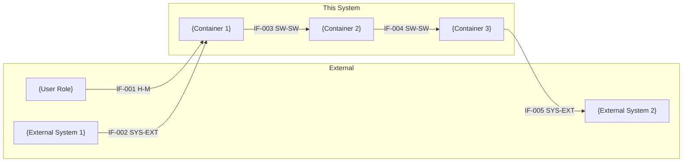

# SE Interfaces

## Purpose

Define and document every interface at every system boundary.
An interface is any point where information, energy, material,
or control crosses a boundary between the system and the outside
world, or between major subsystems within the system.

Interfaces are where systems fail. An undocumented interface
is an unmanaged risk. This skill produces an Interface Control
Document (ICD) that becomes the authoritative reference for
all interface agreements, and the input to integration testing.

This skill follows interface management best practice and
the SysML Internal Block Diagram (IBD) conceptual model.

Output artifacts:

- `specs/system/06-interfaces/icd.md`
- `specs/features/$FEATURE_ID/06-interfaces/interfaces-delta.md` (feature delta)

Updates:

- `specs/system/rtm.md`
- `specs/system/09-vv/vv-plan.md`
- `specs/system/10-risk/risk-register.md`

## Pre-Conditions

- `.specify/memory/constitution.md` must exist. Read it.
- `specs/system/05-architecture/architecture.md`
  must exist. Read it.
- `specs/system/05-architecture/views/context.md`
  must exist. Read it — this defines the external interfaces.
- `specs/system/05-architecture/views/container.md`
  must exist. Read it — this defines the internal interfaces.
- `specs/system/04-requirements/requirements-register.md`
  must exist. Read it — interface requirements need tracing.
- `specs/system/01-conops/conops.md` must exist. Read it.
  External dependencies and dependents are listed there.

If architecture views do not exist, stop and tell the user
to run `/thing.se-architecture` first.

## Interface Classification

Apply these interface types consistently throughout the skill:

| Code | Type | Description |
| ---- | ---- | ----------- |
| SW-SW | Software-Software | Two software components exchanging data or control |
| SW-HW | Software-Hardware | Software controlling or reading hardware |
| HW-HW | Hardware-Hardware | Direct hardware-to-hardware connection |
| H-M | Human-Machine | User interaction with the system |
| SYS-EXT | System-External | This system to an external system or service |
| PWR | Power | Electrical power supply interface |
| MECH | Mechanical | Physical mounting, connector, or structural interface |
| ENV | Environmental | System boundary with its physical environment |

## Interface Ownership

Every interface has exactly two sides: a **provider** and a
**consumer**. For each interface, ownership must be declared:

- **Owned:** this project controls the specification of this side
- **External:** another team, vendor, or standard controls this side
- **Negotiated:** both sides are under active development and
  the specification is jointly agreed

An interface where both sides are External is not an interface
the project manages — it is a dependency to monitor.

## Baseline-Update Mode

The system-level artifacts this skill writes are a baseline: one
current description of the whole system, not a log of features.
This applies to:

- `specs/system/06-interfaces/icd.md`

and to every edit this skill makes to a threaded artifact (risk
register, V&V plan, RTM).

Before writing, check whether each artifact already exists.

- **Does not exist** — this is the first feature to touch it.
  Write it from the template in the Instructions below.
- **Exists** — merge into it. Never add a section for this feature
  (no "§7 Feature 011", no "Feature 012 additions") and never
  write a second copy of a table that already exists.

When merging:

1. Read the existing artifact in full before changing anything.
2. Interfaces live in one register table for the whole system,
   with one definition section per interface. Open interface
   issues and external specifications each live in one table. The
   interface matrix shows the current system.
3. Add new rows to the existing table. Edit changed rows in place;
   where the history matters, add
   "revised {YYYY-MM-DD}, {feature ID}" to the row's notes.
4. Retire rows that are no longer true: strike through the text
   (`~~…~~`), set the status to `Deprecated` in the register and
   the definition section, and keep the row so its ID stays
   reserved. Record the reason in the feature delta, not in the
   baseline.
5. Rewrite prose so it describes the system as it is after this
   feature. A sentence this feature has made untrue is corrected,
   not left standing beside a newer one.
6. Keep IDs stable. Never renumber and never reuse an ID. New IDs
   start at the highest existing ID + 1.
7. Set the header to `**Baseline as of:** {feature ID}, {date}`.

Then list the services, interfaces, behaviours and constraints
this feature adds, removes or changes. Search the artifacts of
this and earlier development steps for statements about each
one:

- `specs/system/00-stakeholders/`
- `specs/system/01-conops/`
- `specs/system/02-nfr/`
- `specs/system/04-requirements/`
- `specs/system/05-architecture/`
- `specs/system/06-interfaces/`
- `specs/system/rtm.md` (threaded; this skill updates it)
- `specs/system/09-vv/vv-plan.md` (threaded; this skill updates it)
- `specs/system/10-risk/risk-register.md` (threaded; this skill updates it)

Correct every statement in them that the feature has made
untrue, including in artifacts that earlier skills own.
Re-assess every risk, V&V entry or RTM row in the artifacts
above whose mitigation or subject the feature removes or
changes.

Finally, write the feature delta
`specs/features/$FEATURE_ID/06-interfaces/interfaces-delta.md`
using the template at `artifacts/baseline-delta.md`. If it already
exists (this skill ran earlier for the same feature), append to
its tables. Record:

- **System Changes** — the list above
- **Baseline Edits** — one row per item or prose section added,
  changed or retired, in any artifact listed above, with the
  reason
- **Statements Checked** — existing statements reviewed against
  the System Changes and left unchanged because they are still
  true

Write the delta on the first feature too; there every edit is
`Added`.

## Instructions

### Step 1 — Read Context

Read all pre-condition artifacts. Build a complete list of:

- All external actors from the context view
- All containers and their connections from the container view
- All external systems named in the ConOps
- Any interface requirements already in the requirements register
- The system type (SW-only, SW+HW, full system) from the
  constitution — this determines which interface types apply

### Step 2 — Enumerate All Interfaces

Tell the user: *"We will now systematically identify every
interface this system has — internal and external. I'll work
through the interface types one by one. For each interface
found, we'll capture who owns it, what crosses it, and how."*

Work through each applicable interface category:

#### External System Interfaces (SYS-EXT)

For each external system or service identified in the
context view and ConOps:

1. What is the name and description of the external system?
2. Who owns the external system — is its interface specification
   under our control, their control, or a published standard?
3. What data or control flows from our system to theirs?
4. What data or control flows from their system to ours?
5. What protocol governs the exchange?
   (e.g. REST/HTTPS, MQTT, AMQP, gRPC, MODBUS, CAN,
   HL7 FHIR, DICOM, OPC-UA, file transfer, shared database)
6. What is the data format?
   (e.g. JSON, XML, Protobuf, CSV, binary, DICOM, HL7 v2)
7. What are the timing characteristics?
   (e.g. synchronous request-response, async event-driven,
   periodic polling interval, maximum latency requirement)
8. What authentication or security applies to this interface?
9. What happens if this interface is unavailable?
   (degraded mode, fail safe, queue and retry)
10. Is there an existing interface specification document
    we must conform to? If so, record its reference.

#### Human-Machine Interfaces (H-M)

For each user role identified in the stakeholder register:

1. What is the interaction modality?
   (e.g. GUI, CLI, touchscreen, physical controls,
   voice, API used by a technical operator)
2. What does the user provide to the system through
   this interface?
3. What does the system present to the user through
   this interface?
4. Are there accessibility requirements for this interface?
   (reference NFR-USE entries)
5. Are there applicable UI standards or style guides?
6. For physical controls: what are the labelling,
   colour coding, and ergonomic requirements?

#### Internal Software Interfaces (SW-SW)

For each connection between containers identified in
the container view:

1. What is the name of this interface?
2. Which container is the provider and which is the consumer?
3. What is the communication mechanism?
   (e.g. REST API, gRPC, message queue, shared memory,
   function call, event bus, database read/write)
4. What data is exchanged? Describe the payload structure.
5. What are the timing and performance characteristics?
   (synchronous/async, expected latency, throughput)
6. What is the error handling contract?
   (what does the consumer do if the provider is unavailable
   or returns an error?)
7. Is there an API specification? (OpenAPI, Protobuf schema,
   message schema, or to be defined)

#### Software-Hardware Interfaces (SW-HW)

*(Hardware systems only)*

For each connection between a software component and a
hardware element:

1. What hardware element does the software interface with?
2. What is the interface mechanism?
   (e.g. device driver, HAL, BSP, register map, GPIO,
   I2C, SPI, UART, USB, PCIe, memory-mapped IO)
3. What does the software send to the hardware?
   (commands, configuration, data, power control signals)
4. What does the hardware return to the software?
   (sensor readings, status, interrupts, error flags)
5. What are the timing requirements?
   (sampling rate, command response time, interrupt latency)
6. Are there hardware abstraction layer (HAL) requirements
   that isolate software from hardware specifics?
7. Are there safety requirements on this interface?
   (e.g. watchdog, safe state on communication loss,
   plausibility checking of sensor values)

#### Hardware-Hardware Interfaces (HW-HW)

*(Electronics systems only)*

For each direct hardware-to-hardware connection:

1. What are the two hardware elements?
2. What is the interface type?
   (digital bus, analogue signal, power rail, RF, optical)
3. What are the electrical characteristics?
   (voltage levels, current requirements, impedance,
   frequency range, signal integrity requirements)
4. What connector or physical medium is used?
5. Are there EMC or isolation requirements on this interface?

#### Power Interfaces (PWR)

*(Hardware systems only)*

For each power supply interface:

1. What is the power source?
   (mains AC, battery, PoE, solar, vehicle 12V/24V,
   USB power delivery)
2. What voltage and current does each subsystem require?
3. Are there power sequencing requirements?
   (which subsystems must power up before others)
4. What happens on power loss?
   (graceful shutdown, battery backup, safe state)
5. Are there isolation requirements between power domains?

#### Mechanical Interfaces (MECH)

*(Full systems with mechanical content only)*

For each mechanical interface:

1. What two elements meet at this interface?
2. What is the connection type?
   (bolted joint, press fit, snap fit, connector,
   cable gland, panel cutout)
3. What are the dimensional requirements?
   (mounting pattern, clearance, ingress protection rating)
4. What environmental loads does this interface carry?
   (vibration, shock, thermal expansion, sealing)

### Step 3 — Identify Interface Risks

For each interface enumerated, ask:

1. Is the interface specification under our control,
   or do we depend on an external party to define or
   maintain it?
2. Is there a risk that the external party changes the
   interface without notice?
3. Is the interface novel or unproven in this application?
4. Does the interface cross a safety boundary?
5. Is the timing or performance requirement on this
   interface at the edge of what is technically feasible?

### Step 4 — Write the ICD

Write `specs/system/06-interfaces/icd.md`, or merge into it if it
exists (see Baseline-Update Mode):

````markdown
# Interface Control Document

**System:** {system name}
**Baseline as of:** {feature ID}, {date}
**Feature deltas:** `specs/features/*/**/*-delta.md`
**Status:** DRAFT
**Last Updated By:** se-interfaces skill

---

## Purpose

This document defines all interfaces at every boundary of
the system. It is the authoritative reference for interface
agreements between this system and external systems, between
subsystems, and between software and hardware.

Every interface listed here must have a corresponding
verification entry in the V&V plan.

---

## Interface Register

| IF ID | Name | Type | Provider | Consumer | Provider Ownership | Consumer Ownership | Status |
| ----- | ---- | ---- | -------- | -------- | ------------------ | ------------------ | ------ |
| IF-001 | {name} | SYS-EXT | {provider} | {consumer} | Owned/External/Negotiated | Owned/External/Negotiated | Draft |

---

## Interface Definitions

### IF-{NNN} — {Interface Name}

**Type:** {interface type code}
**Provider:** {name and system/component}
**Consumer:** {name and system/component}
**Provider Ownership:** {Owned | External | Negotiated}
**Consumer Ownership:** {Owned | External | Negotiated}
**Status:** Draft | Agreed | Baselined | Deprecated
**Requirement Source:** {REQ-ID or NFR-ID that mandates this interface}

#### Description
{One paragraph describing what this interface does and
why it exists in the system.}

#### Protocol and Format

| Property | Value |
| -------- | ----- |
| Mechanism | {REST, MQTT, CAN, I2C, GPIO, etc.} |
| Data Format | {JSON, Protobuf, binary, register map, etc.} |
| Direction | {Bidirectional, Provider→Consumer, Consumer→Provider} |
| Timing | {Synchronous, Async, Periodic — specify interval/latency} |
| Authentication | {method or None} |
| Encryption | {method or None} |

#### Data Elements

| Element | Type | Range/Values | Units | Description |
| ------- | ---- | ------------ | ----- | ----------- |
| {name} | {int, float, string, enum, struct} | {range or enum values} | {unit or N/A} | {description} |

#### Error Handling

| Condition | Provider Behaviour | Consumer Behaviour |
| --------- | ------------------ | ------------------ |
| Timeout | {what provider does} | {what consumer does} |
| Invalid data | {what provider does} | {what consumer does} |
| Unavailable | N/A | {degraded mode, retry, fail safe} |

#### Verification

**Verification Method:** {T | A | I | D}
**Verification Stage:** {IT | ST | AT}
**Pass Criterion:** {specific, measurable criterion}

#### External Reference
{Link or citation to external interface specification,
standard, or vendor datasheet. "None — this interface
is fully defined here" if self-contained.}

---

## Interface Matrix

*N² diagram — shows all interfaces between all system elements.
A cell is populated if an interface exists between the row
element and the column element.*



---

## Open Interface Issues

| Issue ID | Interface | Issue Description | Owner | Target Resolution |
| -------- | --------- | ----------------- | ----- | ----------------- |

---

## External Specifications Referenced

| Reference ID | Document Title | Version | Owner | Location |
| ------------ | -------------- | ------- | ----- | -------- |
````

### Step 5 — Update Threaded Artifacts

#### V&V Plan Update

For each interface defined, add a verification entry to
`specs/system/09-vv/vv-plan.md`:

- Req ID: use the IF-ID as the identifier
- Type: Interface
- Description: interface name
- Method: typically Integration Test (IT) for internal
  interfaces, System Test (ST) for external interfaces
- Pass Criterion: from the verification section of each
  interface definition

#### RTM Update

For each requirement in the requirements register that
references an interface, update the Design Element column
in `specs/system/rtm.md` to reference the IF-ID.

#### Risk Register Update

**Risk ID assignment:** Before appending new entries, scan
the register for all existing `RISK-NNN` IDs and determine
the maximum N. Assign new IDs starting from `max_N + 1`.
Never derive the next ID from the last row alone — use the
maximum across the entire document to prevent collisions.
Set `Status` = `Open` and `Residual P`, `Residual C`,
`Residual Level` = `—` for all newly created entries.
Update the Summary table counts after adding entries.

For each interface risk identified in Step 3, add an
entry to `specs/system/10-risk/risk-register.md`.

Default risk scoring for interface risks:

- External interface with no specification under our
  control: P=3, C=4
- Safety-critical interface: P=2, C=5
- Novel or unproven interface mechanism: P=3, C=3

### Step 6 — Confirm Completion

Report to the user:

1. Total interfaces defined, broken down by type
2. Interfaces by ownership status:
   - Fully owned (both sides)
   - Partially external (one side)
   - Fully external (both sides — monitoring only)
3. Interfaces with incomplete specifications (TBD fields)
4. Number of V&V plan entries added
5. Number of risk entries added
6. Any open interface issues recorded
7. Recommended next skill:
   `/thing.se-gate 3`
   (Phase 3 gate before proceeding to implementation planning)

Also report the feature delta path, the number of baseline
items added, changed and retired, and every statement corrected
in an artifact this skill does not own.
