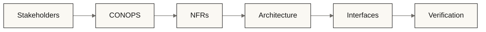

# THING Diagram Language

THING diagrams should feel like engineering artifacts, not decorative illustrations.

The diagram system should support:

- systems engineering reasoning
- traceability
- artifact relationships
- workflow sequencing
- interface boundaries
- risk and verification visibility
- calm technical readability

The preferred diagram feel:

> topology, not spectacle.

---

## Core Principles

### 1. Diagrams Must Govern Understanding

A THING diagram should answer at least one of these questions:

- What relates to what?
- What flows into what?
- What constrains what?
- What verifies what?
- Where is the boundary?
- What decision does this diagram make visible?

If a diagram only decorates the page, remove it.

---

### 2. Use Few Visual Concepts

Default visual vocabulary:

| Visual Element | Meaning |
|---|---|
| Rectangle | artifact, system element, workflow step |
| Circle / small node | connector, trace point, decision junction |
| Solid arrow | flow, dependency, sequence |
| Dashed arrow | trace, influence, non-control relationship |
| Boundary box | scope, system, context, subsystem |
| Muted grid / line | structure, not content |
| Accent line | selected path or governing relationship |

Avoid complex icons unless they encode real meaning.

---

### 3. Keep Color Sparse

Recommended default:

- background: `#F3F1EC`
- main line/text: `#161616`
- secondary line/text: `#6E6B67`
- grid/trace lines: `#C9C5BD`
- primary accent: `#273248`
- secondary accent: `#4A4458`

A good THING diagram usually needs:

- one neutral background
- one text color
- one line color
- one accent color

Not more.

---

## Preferred Tools

### Recommended: D2

D2 is the best fit for THING’s identity because it is:

- diagram-as-code
- topology-oriented
- clean by default
- suitable for architecture and workflow diagrams
- Git-friendly
- less ornamental than many alternatives

Use D2 for:

- workflow maps
- artifact dependency graphs
- context diagrams
- interface maps
- traceability diagrams
- verification chain diagrams

### Also Acceptable: Mermaid

Use Mermaid when:

- GitHub-native rendering is important
- the diagram is simple
- contributors should not need extra tooling

Use Mermaid for:

- simple flowcharts
- sequence diagrams
- small dependency maps

### Use Sparingly: PlantUML

Use PlantUML when:

- UML notation is specifically useful
- sequence or component notation needs more rigor
- the audience expects UML

Avoid PlantUML when it turns into diagram theater.

---

## Visual Style Rules

### Lines

Use thin lines.

Avoid:

- heavy strokes
- arrows everywhere
- decorative connectors
- thick rounded startup-card boxes

### Layout

Prefer:

- left-to-right flow for process
- center-out topology for traceability
- bounded context boxes for architecture
- vertical stacking only when sequence matters

### Labels

Use short labels.

Good:

```text
CONOPS
NFR
Architecture
Interface
Verification
```

Avoid:

```text
This document contains the complete concept of operations for the target system
```

Put prose below the diagram, not inside it.

---

## Diagram Types

### 1. Workflow Sequence Diagram

Shows an ordered process.

Use for:

- command workflows
- agent activities
- engineering phases

### 2. Artifact Dependency Graph

Shows upstream/downstream artifact relationships.

Use for:

- systems engineering structure
- traceability
- repository documentation maps

### 3. Boundary / Context Diagram

Shows what is inside and outside scope.

Use for:

- Concept of Operations
- architecture context
- interface control

### 4. Interface Diagram

Shows connections and contracts between elements.

Use for:

- ICDs
- subsystem boundaries
- external system dependencies

### 5. Traceability Diagram

Shows how intent flows into verification.

Use for:

- stakeholder → CONOPS → NFR → architecture → verification
- risk → mitigation → verification

---

## Standard THING Traceability Chain

The canonical diagrammatic spine of THING is:

```text
Stakeholders
  → Concept of Operations
  → Requirements
  → Architecture
  → Interfaces
  → Verification
  → Validation
```

Risk management may attach across the entire chain.

This relationship should appear repeatedly in the identity.

---

## Diagram Anti-Rules

Avoid:

- AI brains
- glowing nodes
- neural networks
- fake holograms
- blockchain hexagons
- generic cloud icons
- mascot-like symbols
- excessive UML ceremony
- boxes that only restate headings
- diagrams with no engineering decision

---

## D2 Style Guidance

Use D2 for primary diagrams.

Recommended layout:

```d2
direction: right
```

Recommended style:

```d2
vars: {
  bg: "#F3F1EC"
  ink: "#161616"
  stone: "#6E6B67"
  line: "#C9C5BD"
  indigo: "#273248"
}

classes: {
  artifact: {
    style: {
      fill: ${bg}
      stroke: ${ink}
      stroke-width: 1
      border-radius: 4
    }
  }
}
```

Keep style definitions centralized when possible.

---

## Mermaid Style Guidance

Mermaid is useful for GitHub-native rendering, but its defaults are less aligned with THING.

Use Mermaid when portability matters more than visual precision.

Add init styling where supported:



---

## Diagram Review Checklist

Before accepting a diagram, ask:

- [ ] Does it answer a real engineering question?
- [ ] Are the boundaries clear?
- [ ] Are relationships typed or visually distinguishable?
- [ ] Could it be understood at README scale?
- [ ] Does it avoid decorative AI/startup imagery?
- [ ] Does every color have a job?
- [ ] Is the diagram still readable in monochrome?
- [ ] Does it support traceability?
- [ ] Would it still look reasonable printed?

---

## Documentation Placement

Suggested repo structure:

```text
docs/
  diagrams/
    diagram-language.md
    examples/
      traceability-chain.d2
      workflow-map.d2
      system-context.d2
      mermaid-traceability.md

branding/
  diagrams/
    thing-diagram-theme.d2
    thing-diagram-tokens.json
```

---

## Identity Principle

THING’s diagrams should communicate:

> disciplined relationships between artifacts, decisions, and verification.

They should not communicate:

> technology magic.
